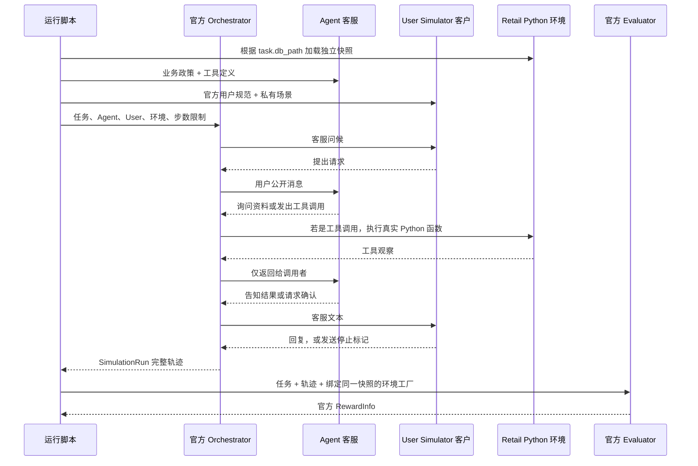

# 从一条真实 Episode 理解 PolicyTrace-RL

这份说明对应已保存的 DeepSeek 实测，不调用新的模型 API。

## 先认清四个参与者

| 参与者 | 这轮使用什么 | 负责什么 | 能看到什么 |
|---|---|---|---|
| Agent：客服 | DeepSeek API + 上游 LLMAgent | 决定问什么、调用哪个工具、传哪些参数、怎样答复 | 业务政策、工具 Schema、公开对话和自己的工具观察 |
| User Simulator：客户 | 另一个 DeepSeek 上下文 + 上游 UserSimulator | 扮演指定客户、提供资料、确认或拒绝、结束对话 | 官方用户规范、任务私有用户场景、双方公开对话 |
| Environment：商店 | 上游 Python RetailTools + RetailDB | 查账户、查订单、执行地址修改等 | 当前 Episode 的独立数据库 |
| Evaluator：评分 | 上游 Python 官方评分器 | 重建实际与参考终态，按任务 reward basis 评分 | 任务评分条件、实际轨迹、正确初始数据库 |

两个 DeepSeek 角色使用同一模型服务，但维护各自的历史和系统提示词。共用 HTTP 客户端/费用账本不会让模型自动共享上下文。后续 Student 是 Qwen；User Simulator 可以继续使用固定 API 模型。

官方 Orchestrator 是“传递消息和控制回合”的程序。它不替模型作业务决策。第 0 条客服问候是程序提供的固定文本，后续客服与客户回答才由模型生成。

## Episode 的起点和终点

一次 Episode 是一个任务从独立初态出发，经过多轮用户/Agent/工具交互，直到停止，再计算奖励的完整运行。



每次收到模型回复，Orchestrator 根据消息类型决定下一站：文字发给对方，工具调用交给环境。工具结果来自 Python/数据库，不是由模拟用户或 Agent 编造。

## 真实案例 retail_131：修改默认地址

初始化时读取 `tau2_retail_new_db_4.json`，建立只属于本次 Episode 的数据库副本。客户的邮箱、搬家目标与新地址来自其私有任务说明；Agent 不会拿到这些隐藏说明。

以下是实际对话的中文意译；编号对应保存轨迹的消息序号。

| 序号 | 谁执行 | 实际内容或动作 | 程序发生了什么 |
|---|---|---|---|
| 0 | Orchestrator | 固定问候：“你好，有什么可以帮你？” | 将客服消息交给用户模拟器 |
| 1 | User | “我搬家了，需要更新账户默认送货地址。” | 用户模型只透露当前诉求 |
| 2 | Agent | “先确认身份，请提供邮箱或姓名和邮编。” | 客服模型生成询问信息 |
| 3 | User | 提供任务里的邮箱 | 用户回复成为 Agent 的下一轮输入 |
| 4 | Agent | `find_user_id_by_email(email=...)` | 模型输出结构化工具调用 |
| 5 | Environment | 返回 `max_bell_802` | Python 查询快照；没有调用模型 |
| 6 | Agent | 请求完整新地址，包括国家 | 继续与用户交谈 |
| 7 | User | 提供街道、公寓、Austin、TX、78701、`United States` | 客户补充国家英文全称 |
| 8 | Agent | 复述新地址，请求确认 | 修改前征求客户确认 |
| 9 | User | “正确，请更新。” | 客户模型确认 |
| 10 | Agent | `modify_user_address(..., country="United States")` | 模型决定更新参数 |
| 11 | Environment | 返回修改后的账户资料，`error=False` | Python 真正更新此 Episode 的数据库 |
| 12 | Agent | 告知更新完成，询问是否还有其他需求 | 客服模型答复 |
| 13 | User | 致谢并发送 `###STOP###` | Orchestrator 结束，termination=user_stop |

工具参数来自 Agent；用户的“请更新”本身不会直接修改数据库。数据库没有写回原始 snapshot，下一条 Episode 会重新从初态建立副本。

评分阶段，官方 Evaluator 使用同一原始快照创建两个新环境：一个重放真实工具轨迹，一个按任务参考动作构造目标终态，然后比较数据库哈希。本例唯一终态差异是国家字段 `United States` 与参考 `USA`，所以原始官方 reward 是 **0**。

离线诊断副本只将 country 参数换成 `USA`，重新执行工具并评分后得到 1。这个诊断证明接口和初态传递正常；原始模型轨迹和原始分数仍保留为 0。遗漏参考中的一次只读查询并不是本例 DB 奖励为 0 的原因。

这条 Episode 的“工具执行成功”“客户认为已完成”“官方评分通过”是三个不同事实。前两项成立，最后一项不成立。

## 真实案例 retail_152：拒绝跨品类替换

客户想把待处理订单中的 T-shirt 换成跑鞋。政策只允许同一商品的不同规格，不能换成完全不同商品类型。

实际执行顺序：客户提出诉求 → Agent 询问邮箱 → 客户提供邮箱 → 查询用户 ID → 客户表示不记得订单号 → 查询用户账户 → 查询订单 → Agent 解释政策并拒绝 → 客户接受解释 → 双方收尾 → 用户发送停止标记。

三次工具调用全部成功，没有修改数据库，官方 reward=1。客户没有利用私有说明直接告诉客服订单号，且接受拒绝并正常停止，主要行为合理。不过场景要求认证后再提具体替换请求，实际客户在第一句话就透露了；这是一处任务遵循偏差。

本任务的参考动作都是只读，通信条件又为空，官方奖励对业务解释质量的覆盖有限。这里结合真实对话确认了拒绝合理；不能仅凭 DB match=1 就推出所有拒绝任务都完成得很好。

## DeepSeek 能否用于模拟客户

目前可以作为开发和链路验证阶段的 User Simulator 候选。两次交互都有明确诉求、合理的身份信息、连贯回应和解释得通的终止，没有工具路由异常。

正式 RL 前仍需要固定开发小集验证。需要重点记录：是否改变目标、编造身份/订单信息、泄漏隐藏规则或过早提供资料、确认是否合理、是否过早停止或反复拖延。这两条样本尚不能给出其稳定性比例。

SFT 中的专家 Agent 与模拟客户承担不同职责。模拟客户不需要生成专家工具解法，但其资料和行为必须稳定，否则训练的状态分布和终局奖励会被扰动。地址任务尤其展示了模拟用户措辞、Agent 参数处理、原始任务缺少国家规定与严格评分共同作用的问题，不能全部归因于模型能力不足。

## 项目文件怎么读

| 位置 | 用途 | 建议阅读顺序 |
|---|---|---:|
| `scripts/stage0_deepseek_smoke.py` | 把任务、数据库、Agent、User、Orchestrator、Evaluator 串起来 | 1 |
| `src/policytrace/stage0/task_loader.py` | 把原始任务转成上游 Task，保存 db_path | 2 |
| `src/policytrace/stage0/db_adapter.py` | 校验并加载快照，每次创建独立环境 | 3 |
| `src/policytrace/stage0/evaluator_adapter.py` | 确保官方评分两侧使用同一初态 | 4 |
| `src/policytrace/stage0/deepseek_client.py` | 发 HTTP 请求、限长、不重试、记录累计预算 | 5 |
| `external/tau2-bench/` | 上游业务工具、用户规范、状态机和评分源码 | 需要了解实现时阅读 |
| `tests/stage0/` | 用测试检查接口、隔离、评分与消息路由 | 与对应模块一起阅读 |
| `reports/stage0/` | 轻量统计、版本、结果和解释 | 阅读结论时使用 |
| `data/raw/` | 不修改的原始数据和数据库 | 不提交 Git |
| `data/private/stage0/deepseek/` | 完整真实轨迹、用户私有 prompt、费用账本和奖励 | 本地审查，不作为 Student 输入 |

现阶段使用官方 Orchestrator。Stage 3 才按项目规划实现自己的 Agent Harness；本次链路验证不代表自研 Harness 已完成。

## 在自己的终端看完整过程

从项目根目录运行：

```powershell
.venv\Scripts\python -X utf8 scripts/stage0_replay.py --task-id retail_131 --validate
.venv\Scripts\python -X utf8 scripts/stage0_replay.py --task-id retail_152 --validate
```

默认精简账户/订单工具结果，便于阅读；添加 `--full-tools` 显示原始完整观察。`--validate` 会用固定任务和快照离线重新调用官方评分器，并检查与保存结果一致。**这些命令不发起模型请求，费用为 0。** 两条命令已实际运行验证。

## Windows、WSL 和云 GPU 各验证什么

| 环境 | 当前/后续验证内容 | 什么时候做 |
|---|---|---|
| Windows CPU | 数据、工具、数据库隔离、评分和远程 API 对话 | 已完成 |
| WSL2 Ubuntu CPU | Linux 下 Python 依赖、路径、工具与评分兼容 | 安装初始化后；可以不租卡完成 |
| 云服务器 | 目标 Linux 环境的快速复验，以及 CUDA、模型加载、训练/推理和显存 | 实际开始 GPU 开发时 |

不必为了 Stage 0 现在租卡。以后云环境到位，仍应运行一次 CPU 检查，再做短模型/训练 smoke，以发现云机依赖、网络和 GPU 运行时差异。无需重复支付这两条 DeepSeek 测试，也无需每换环境都重新遍历全部原始任务。

WSL 能提前排查 Linux 问题，不能代替云 GPU 验证。Windows 的 `.venv` 不能直接当作 Linux 虚拟环境使用；Linux 必须另建环境，并复用固定版本和原始数据。
